# Architecture graph

Generated by `lifeos arch --write docs/ARCHITECTURE-GRAPH.md` from the real imports. Do not edit by hand: a test fails when this file no longer matches the code.

50 modules, 154 import edges, 7 depths (depth 0 imports no other engine module; an arrow points from the importer to what it uses).

```mermaid
graph BT
  subgraph L0[depth 0]
    arch[arch]
    check[check]
    guard[guard]
    home[home]
    hooks[hooks]
    labcard[labcard]
    labscore[labscore]
    policy[policy]
    release[release]
    seats[seats]
    selftest[selftest]
    store[store]
    tasks[tasks]
    verify[verify]
  end
  subgraph L1[depth 1]
    backup[backup]
    bakeoff[bakeoff]
    calibrate[calibrate]
    context[context]
    governor[governor]
    history[history]
    kaizen[kaizen]
    lab[lab]
    learn[learn]
    log[log]
    pipeline[pipeline]
    redact[redact]
    runs[runs]
    savings[savings]
    study[study]
    vocab[vocab]
    week[week]
  end
  subgraph L2[depth 2]
    ask[ask]
    cockpit[cockpit]
    decision[decision]
    digest[digest]
    exam[exam]
    experiment[experiment]
    mistakes[mistakes]
    router[router]
    showcase[showcase]
  end
  subgraph L3[depth 3]
    canary[canary]
    delegate[delegate]
    panel[panel]
    replay[replay]
    sortcsv[sortcsv]
  end
  subgraph L4[depth 4]
    demo[demo]
    mcp[mcp]
    numbers[numbers]
  end
  subgraph L5[depth 5]
    prove[prove]
  end
  subgraph L6[depth 6]
    cli[cli]
  end
  ask --> check
  ask --> context
  ask --> guard
  ask --> policy
  ask --> seats
  ask --> store
  backup --> verify
  bakeoff --> guard
  bakeoff --> store
  calibrate --> guard
  calibrate --> store
  canary --> ask
  canary --> guard
  cli --> arch
  cli --> ask
  cli --> backup
  cli --> bakeoff
  cli --> calibrate
  cli --> canary
  cli --> cockpit
  cli --> context
  cli --> decision
  cli --> delegate
  cli --> demo
  cli --> digest
  cli --> exam
  cli --> experiment
  cli --> governor
  cli --> guard
  cli --> history
  cli --> home
  cli --> hooks
  cli --> kaizen
  cli --> lab
  cli --> labcard
  cli --> learn
  cli --> log
  cli --> mcp
  cli --> mistakes
  cli --> numbers
  cli --> panel
  cli --> pipeline
  cli --> prove
  cli --> redact
  cli --> release
  cli --> replay
  cli --> router
  cli --> runs
  cli --> savings
  cli --> seats
  cli --> selftest
  cli --> showcase
  cli --> sortcsv
  cli --> store
  cli --> study
  cli --> tasks
  cli --> verify
  cli --> vocab
  cli --> week
  cockpit --> guard
  cockpit --> kaizen
  cockpit --> log
  cockpit --> runs
  cockpit --> store
  cockpit --> study
  cockpit --> tasks
  cockpit --> week
  context --> home
  decision --> calibrate
  decision --> guard
  decision --> tasks
  delegate --> ask
  delegate --> check
  delegate --> context
  delegate --> learn
  delegate --> seats
  delegate --> store
  demo --> ask
  demo --> guard
  demo --> panel
  demo --> replay
  demo --> verify
  digest --> store
  digest --> study
  exam --> guard
  exam --> log
  exam --> store
  experiment --> guard
  experiment --> learn
  experiment --> store
  governor --> seats
  governor --> store
  history --> guard
  kaizen --> store
  lab --> guard
  lab --> home
  lab --> labcard
  lab --> labscore
  lab --> store
  learn --> guard
  learn --> seats
  learn --> store
  log --> guard
  log --> store
  mcp --> ask
  mcp --> bakeoff
  mcp --> cockpit
  mcp --> context
  mcp --> delegate
  mcp --> exam
  mcp --> kaizen
  mcp --> log
  mcp --> router
  mcp --> runs
  mcp --> showcase
  mcp --> store
  mcp --> tasks
  mcp --> week
  mistakes --> study
  numbers --> calibrate
  numbers --> canary
  numbers --> learn
  numbers --> savings
  numbers --> store
  numbers --> verify
  numbers --> vocab
  panel --> ask
  panel --> context
  panel --> store
  pipeline --> guard
  prove --> canary
  prove --> numbers
  prove --> verify
  redact --> guard
  replay --> ask
  replay --> context
  replay --> store
  router --> context
  router --> policy
  router --> seats
  router --> store
  runs --> store
  savings --> home
  savings --> store
  showcase --> guard
  showcase --> runs
  showcase --> store
  showcase --> week
  sortcsv --> ask
  study --> guard
  study --> store
  vocab --> guard
  vocab --> store
  week --> store
```

